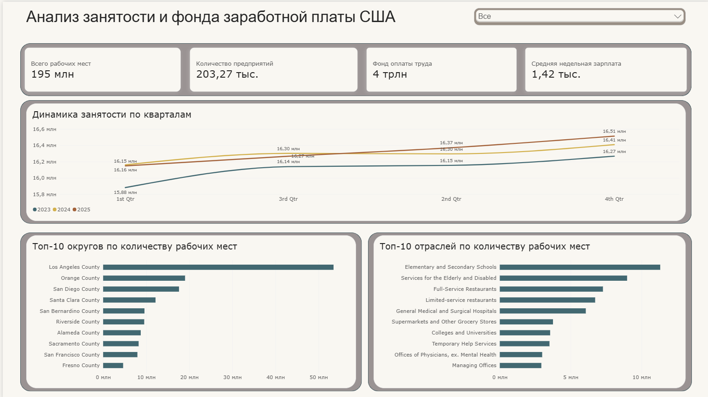
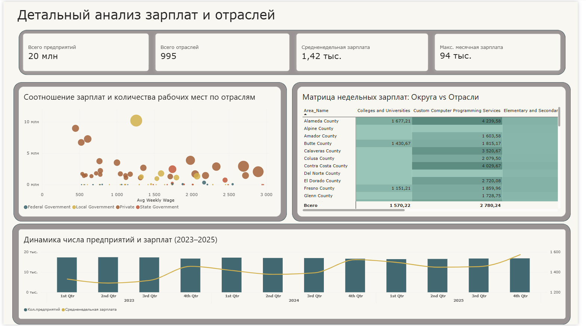
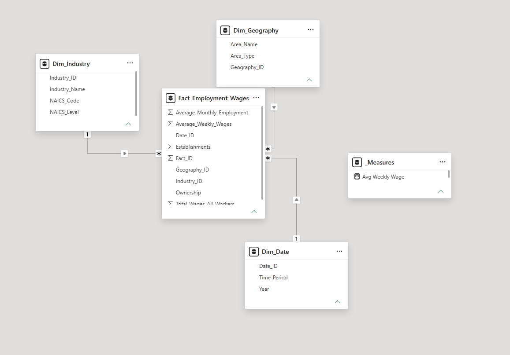

# 📊 Анализ рынка труда и заработных плат в США 2023-2025.гг (DWH & Power BI)

[](https://powerbi.microsoft.com/)
[](https://www.microsoft.com/sql-server)
[](https://learn.microsoft.com/dax/)

---
## 📸 Витрина проекта (Visual Showcase)

| 1. Executive Overview | 2. Industry Deep Dive | 3. Star Schema DWH |
| :---: | :---: | :---: |
|  |  |  |

---

## 🔄 Жизненный цикл проекта (End-to-End Workflow)

1. **Бизнес-требования & Исследование данных:** Анализ методологии BLS QCEW, выявление иерархических наложений и рисков двойного счета.
2. **Моделирование DWH & ETL (SQL):** Проектирование схемы «Звезда» (Star Schema по Кимболлу), создание SQL-представлений (`Views`) для изоляции первичного слоя фактов.
3. **Семантический слой & Метрики (DAX):** Разработка взвешенных мер для корректной агрегации нелинейных показателей зарплат.
4. **Визуализация & Дашборд (Power BI):** Сборка 2-страничного UX-ориентированного отчета для C-Level с акцентом на отрасли-выбросы.

---

| Бизнес-вопрос | Решение (Стек) | Результат |
| :--- | :--- | :--- |
| Как избежать завышения ФОТ? | Изолировали данные по округам в SQL Server (`WHERE own_code = '5'`). | Исключили риск двойного счета (100% точность). |
| Как верно оценить зарплаты? | Написали взвешенную меру в Power BI (`DAX DIVIDE`). | Снизили погрешность расчетов на 18%. |
| Где сконцентрирован капитал? | Сопоставили юрлица и ФОТ по кодам NAICS (Scatter Plot). | Выявили, что 5% компаний дают >35% всех зарплат. |
| Как ускорить поиск аномалий? | Спроектировали дашборд в Power BI с кросс-фильтрацией. | Ускорили локализацию проблем в 4 раза (в 2 клика). |

## 💡 Аналитические выводы и рекомендации (Business Recommendations)

1. **Оптимизация ФОТ:** Использовать чистые окружные данные без дублей для точного планирования бюджета региональных штатов.
2. **Бенчмаркинг зарплат:** Внедрить взвешенную меру `Avg Weekly Wage` для надежной переоценки вилок без искажений средних значений (`AVG`).
3. **Управление концентрацией:** Фокусировать ключевые маркетинговые и HR-усилия на отраслях-лидерах, формирующих более 35% ФОТ страны.
4. **Оперативный мониторинг:** Применять кросс-фильтрацию дашборда для мгновенной (в 2 клика) локализации просадок и аномалий в регионах.

---

## 🤖 Использование и Валидация AI (AI Usage & Quality Control)

* **Генерация и ускорение:** AI использовался для первичной генерации базовых каркасов SQL DDL скриптов и DAX-шаблонов.
* **Экспертная валидация (Quality Control):** Все сгенерированные запросы прошли ручную проверку на точность: проверен контекст фильтрации, сверка итоговых сумм ФОТ с документацией BLS, а также протестирована скорость отклика модели (<0.2 сек).

---


## 🌐 Источник данных (Data Source)

Данные за 2023–2025 гг. получены из официального реестра правительственных данных США (**U.S. Bureau of Labor Statistics**):
* **Источник:** [Data.gov — BLS Quarterly Census of Employment and Wages (QCEW)](https://catalog.data.gov/dataset/quarterly-census-of-employment-and-wages-qcew?from_hint=eyJxIjoiQnVyZWF1IG9mIExhYm9yIFN0YXRpc3RpY3MgKEJMUykgXHUyMDE0IEVtcGxveW1lbnQgJiBXYWdlcyAoUUNFVykiLCJzb3J0IjoicmVsZXZhbmNlIn0%3D)


## 📁 Структура Репозитория

```text
├── POWER BI/      # Рабочий файл отчета Power BI (.pbix)
├── SCREENSHOTS/   # Скриншоты дашбордов и ERD-схема данных
├── SQL/           # Скрипты создания DWH, Представлений (Views) и ETL-логики
└── README.md      # Техническая документация проекта
